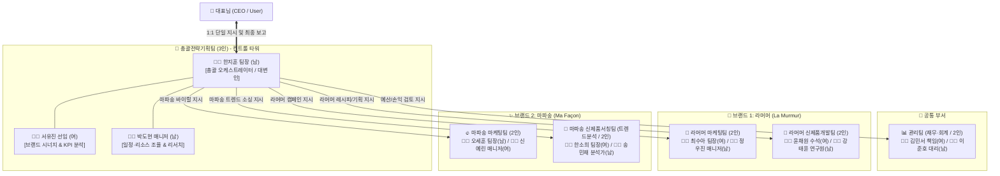

# 🏢 더제이 코퍼레이션 (The J Corporation)
## 싸이월드 미니미(Minime) 부서 & 멀티 에이전틱 시스템 구축 마스터 플랜

> [!IMPORTANT]
> **핵심 아키텍처 & 브랜드 정체성 확정**
> - **회사명**: 더제이 코퍼레이션 (The J Corp.)
>   - **🌸 라머머 (La Murmur | `www.lamurmur.com`)**: **고급 실버 & 14K 파인 주얼리** 전문 브랜드 (자체 디자인·세공·신제품 개발 중심)
>   - **✨ 마파송 (Ma Façon)**: **인플루언서 '블링홍' 픽(Pick) 라이프스타일 셀렉트 브랜드** — 의류, 양말, 심플 데일리 주얼리(합리적 가격대 실버), 잡화 주력. **블링홍이 직접 사입·착용·검증한 아이템 중심 (공동구매 70% + 상시 판매 30%)**
> - **UI 컨셉**: 2000년대 싸이월드 미니홈피 **아이소메트릭(Isometric) 미니룸 & 도트 픽셀 미니미** 오피스 (방식 A: 웹 대시보드 + 멀티 에이전트 시뮬레이터)
> - **조직 규모**: 총 **6개 부서 / 13명 에이전트** (총괄전략기획팀 3명, 나머지 5개 팀 각 2명 / **남 6 : 여 7 골고루 배치**)
> - **보고 체계 (Single Point of Contact)**: 대표님(User) ↔ **총괄전략기획팀장(한지훈 팀장)** 단일 창구 보고 및 지시 하달

---

## 1. 조직도 및 보고 체계 (Reporting Hierarchy)

대표님(CEO)은 여러 에이전트를 일일이 호출할 필요 없이 **총괄전략기획팀장(한지훈 팀장)**에게만 업무를 지시하고 최종 통합 보고를 받습니다.



---

## 2. 팀별 미니미(Minime) 에이전트 라인업 (총 13명 / 남 6 : 여 7)

각 에이전트는 싸이월드 특유의 **도트 캐릭터 외형**, **말풍선 말투**, **전담 AI 툴(역할)**을 가집니다.

### 🎯 [공통] 총괄전략기획팀 (3명 — 남2, 여1)
> **미니룸 구역**: 중앙 펜트하우스 보드룸 (화이트보드, 대형 모니터, 커피머신 배치)

| 미니미 | 이름 / 직급 | 성별 | 미니미 스타일 (도트 컨셉) | 핵심 역할 및 에이전트 프롬프트 기능 |
| :---: | :--- | :---: | :--- | :--- |
| 🧑‍💼 | **한지훈 팀장**<br>*(CEO 직속 보고)* | 남 | 네이비 수트 + 뿔테안경 + 레이저 포인터 | **[총괄 오케스트레이터]** 대표님 지시 수령, 하위 5개 팀 업무 분배, 결과물 취합·검수 후 대표님께 **단일 최종 보고서** 브리핑 |
| 👩‍💻 | **서유진 선임** | 여 | 베이지 자켓 + 단발머리 + 태블릿 PC | **[포트폴리오 & KPI 전략]** 라머머·마파송 브랜드 포지셔닝 차별화, 주간/월간 핵심 성과지표(KPI) 대시보드 정리 |
| 🧑‍💻 | **박도현 매니저** | 남 | 댄디 니트 + 헤드셋 + 다이어리 | **[PMO & 크로스체크]** 부서 간 협업 일정 관리(개발↔마케팅↔재무), 회의록 요약 및 리스크 사전 점검 |

---

### 💼 [공통] 관리팀 — 재무·회계 (2명 — 여1, 남1)
> **미니룸 구역**: 좌측 상단 금고 & 클래식 데스크 존 (주판, 듀얼 엑셀 모니터, 금고 아이템)

| 미니미 | 이름 / 직급 | 성별 | 미니미 스타일 (도트 컨셉) | 핵심 역할 및 에이전트 프롬프트 기능 |
| :---: | :--- | :---: | :--- | :--- |
| 👩‍💼 | **김민서 책임** | 여 | 깔끔한 올림머리 + 오피스 정장 + 계산기 | **[재무·예산 통제]** 브랜드별 마케팅/개발 예산 배정, 원가율(COGS) 및 마진 시뮬레이션, 손익계산서(P&L) 검토 |
| 🧑‍💼 | **이준호 대리** | 남 | 셔츠 소매 걷음 + 안경 + 영수증 파일철 | **[회계·정산 관리]** 캠페인 ROI/ROAS 정산, 외주·발주 비용 추산, 세무·자금 흐름 리포트 작성 |

---

### 🌸 [브랜드 1: 라머머 (La Murmur — `www.lamurmur.com`)] (총 4명 — 여2, 남2)
> **브랜드 핵심**: **고급 실버(925 Sterling Silver) & 14K 골드 파인 주얼리** 전문 브랜드
> **미니룸 구역**: 좌측 하단 우아한 벨벳 & 우드 톤 주얼리 아틀리에 (유리 쇼케이스, 세공 작업대, 보석 루페 배치)

#### ① 라머머 마케팅팀 (2명 — 여1, 남1)
| 미니미 | 이름 / 직급 | 성별 | 미니미 스타일 (도트 컨셉) | 핵심 역할 및 에이전트 프롬프트 기능 |
| :---: | :--- | :---: | :--- | :--- |
| 👩‍🎨 | **최수아 팀장** | 여 | 실크 블라우스 + 14K 네크리스 + 카메라 | **[파인 주얼리 브랜딩 & 룩북]** `lamurmur.com` 자사몰 비주얼 디렉팅, 하이엔드 실버·14K 컬렉션 스토리텔링, 시즌 기프트(기념일/웨딩/선물) 캠페인 기획 |
| 🧑‍🎤 | **정우진 매니저** | 남 | 테일러드 자켓 + 크로스백 + 태블릿 | **[자사몰 퍼포먼스 & VIP CRM]** `lamurmur.com` 유입·전환율(CVR) 최적화, 객단가(AOV) 상승을 위한 레이어드 세트 제안, VIP 재구매/케어 서비스 기획 |

#### ② 라머머 신제품개발팀 (2명 — 여1, 남1)
| 미니미 | 이름 / 직급 | 성별 | 미니미 스타일 (도트 컨셉) | 핵심 역할 및 에이전트 프롬프트 기능 |
| :---: | :--- | :---: | :--- | :--- |
| 👩‍🔬 | **윤채원 수석** | 여 | 화이트 아틀리에 가운 + 보석 루페 + 스케치북 | **[주얼리 디자인 & 라인업 설계]** 고급 실버·14K 신제품 컬렉션 컨셉 도출, 착용감·중량·원석 세팅 스펙 정의, 시그니처 라인 USP 설계 |
| 🧑‍🔬 | **강태윤 연구원** | 남 | 댄디 셔츠 + 캘리퍼스 + 금/은 시세 차트 | **[세공 공정 & 금·은 원가/품질 관리]** 종로/공방 세공 제작 스펙서 작성, 국제 금·은 시세 연동 원가 시뮬레이션, 도금 두께·변색 방지 품질 및 고급 패키징(주얼리 박스·보증서) 관리 |

---

### ✨ [브랜드 2: 마파송 (Ma Façon — 인플루언서 '블링홍' 픽 라이프스타일)] (총 4명 — 남2, 여2)
> **브랜드 핵심**: **인플루언서 '블링홍'이 직접 사입·착용·검증**한 라이프스타일(의류, 양말, 심플 데일리 저가 실버 주얼리, 잡화) — **공동구매(공구) 70% + 상시 판매 30%** 구조
> **미니룸 구역**: 우측 하단 힙한 쇼룸 & 라이브 스튜디오 (전신 거울, 의류 행거, 양말/잡화 디스플레이 월, 공구 타이머 전광판)

#### ① 마파송 마케팅팀 (2명 — 남1, 여1)
| 미니미 | 이름 / 직급 | 성별 | 미니미 스타일 (도트 컨셉) | 핵심 역할 및 에이전트 프롬프트 기능 |
| :---: | :--- | :---: | :--- | :--- |
| 🧑‍🎨 | **오세훈 팀장** | 남 | 트렌디 자켓 + 선글라스 + 확성기 | **[블링홍 공구(70%) 스케줄링 & 폭발적 바이럴]** '블링홍 직접 착용·검증' 스토리 기반 공구 오픈 티징→본오픈→마감임박 타임라인 총괄, 릴스/숏폼 코디 콘텐츠 기획 |
| 👩‍🎤 | **신예린 매니저** | 여 | 스타일리시 니트 + 포인트 양말 + 링라이트 | **[상시몰(30%) 전환 & 찐팬 커뮤니티 소통]** 공구 대박 아이템의 상시 판매 전환 전략, 인스타 라방/Q&A(사이즈·착용감·양말/주얼리 합배송 꿀팁) 응대 스크립트 및 후기 이벤트 |

#### ② 마파송 신제품서칭팀 — 트렌드 분석 (2명 — 여1, 남1)
| 미니미 | 이름 / 직급 | 성별 | 미니미 스타일 (도트 컨셉) | 핵심 역할 및 에이전트 프롬프트 기능 |
| :---: | :--- | :---: | :--- | :--- |
| 👩‍💻 | **한소희 팀장** | 여 | 트렌치코트 + 빅 쇼퍼백 + 패브릭 스와치 | **[블링홍 맞춤형 사입 소싱 & 트렌드 픽]** 블링홍이 직접 입어보고 신어볼 후보군(고감도 데일리룩, 포인트 양말, 가성비 심플 실버링/이어링, 라이프 잡화) 도매/국내외 소싱처 발굴 |
| 🧑‍💻 | **송민재 분석가** | 남 | 후드집업 + 스마트워치 + 수요예측 차트 | **[공구 수요 예측 & 사입/재고 밸런싱]** 공구(70%) 완판 목표 수량 및 리오더 리드타임 계산, 객단가 상승용 번들(옷+양말+심플실버) 조합 분석, 상시 판매(30%) 전환 타당성 데이터 리포트 |

---

## 3. 싸이월드 미니룸 UI & 에이전틱 인터랙션 설계

```
┌─────────────────────────────────────────────────────────────────────────┐
│ 🍊 Cyworld Mini-Office : 더제이 코퍼레이션 (The J Corp.)   TODAY 128 | TOTAL 99,420 │
├───────────────────────────────────────────────┬─────────────────────────┤
│                                               │ 💬 전략기획팀장 직통 보고창 │
│      [💼 관리팀 존]        [🎯 총괄전략기획팀 존]  │ ─────────────────────── │
│       👩‍💼김민서 🧑‍💼이준호    👩‍💻서유진 🧑‍💼한지훈(팀장) │ 👑 대표님:               │
│                             🧑‍💻박도현            │ "이번 달 라머머 신제품이랑 │
│  ───────────────────────────────────────────  │  마파송 트렌드 보고해봐"   │
│                                               │                         │
│   [🌸 라머머 (La Murmur)]   [✨ 마파송 (Ma Façon)]│ 🧑‍💼 한지훈 팀장:          │
│    📣마케팅: 👩‍🎨최수아 🧑‍🎤정우진  📣마케팅: 🧑‍🎨오세훈 👩‍🎤신예린│ "충성! 대표님, 각 팀 소집 │
│    🧪개발팀: 👩‍🔬윤채원 🧑‍🔬강태윤  🔭서칭팀: 👩‍💻한소희 🧑‍💻송민재│  하여 통합 보고드립니다!" │
│                                               │                         │
├───────────────────────────────────────────────┴─────────────────────────┤
│ 🎵 BGM: 프리스타일 - Y (Please Tell Me Why) ⏸ ⏭     [전체 회의 소집] [결재함] │
└─────────────────────────────────────────────────────────────────────────┘
```

### 💡 핵심視覺 & 에이전트 동작 연출
1. **미니미 말풍선 & 이동 애니메이션**:
   - 대표님이 **한지훈 팀장(총괄전략기획팀)**에게 지시를 내리면, 한지훈 팀장 미니미 머리 위에 `"📢 긴급 전략회의 소집!"` 도트 말풍선이 뜹니다.
   - 해당 업무와 관련된 부서 미니미들이 바쁘게 움직이며(`작업중... 💻`, `계산중... 🧮`, `서칭중... 🔍` 상태 표시), 작업이 끝나면 **한지훈 팀장 책상으로 보고서 아이콘(📄)이 날아갑니다.**
2. **일촌평 & 미니룸 방명록 스타일 로그**:
   - 각 팀원이 한지훈 팀장에게 올린 세부 데이터는 하단 **'부서별 일촌평(업무 로그)'** 탭에서 언제든 열람할 수 있습니다.
3. **한지훈 팀장의 최종 브리핑 포맷**:
   - 우측 **CEO 집무실 메신저(네이트온/싸이월드 쪽지 감성)** 창에 한지훈 팀장이 **[1. 핵심 요약 → 2. 라머머 현황 → 3. 마파송 현황 → 4. 재무/예산 검토(관리팀) → 5. 대표님 의사결정 요청사항]** 순서로 깔끔하게 정리해 보고합니다.

---

## 4. 시스템 구현 방식 제안 (Next Step 선택)

이 계획을 바탕으로 실제 구현에 들어갈 때 아래 **2가지 연동 방식** 중 원하시는 방향을 선택해 주시면 즉시 구축을 시작하겠습니다.

1. **방식 A: 웹 대시보드 + 멀티 에이전트 시뮬레이터 (HTML/JS/CSS + LLM 연동)**
   - 브라우저에서 바로 열리는 **싸이월드 미니홈피 스킨 + 도트 미니미 13명 배치 오피스 화면** 구현
   - 대표님이 채팅창에 업무 지시 입력 → 각 부서 미니미가 순차 활성화 → **한지훈 전략기획팀장**이 최종 보고서 출력
2. **방식 B: Antigravity 서브에이전트(`define_subagent`) + 미니룸 관제 보드 결합**
   - 실제 워크스페이스에서 동작하는 프롬프트/스킬 체계를 팀별로 정의하고, 시각적인 싸이월드 미니룸 대시보드에서 업무 현황과 산출물(기획서, 트렌드 리포트, 예산안 파일)을 관리
